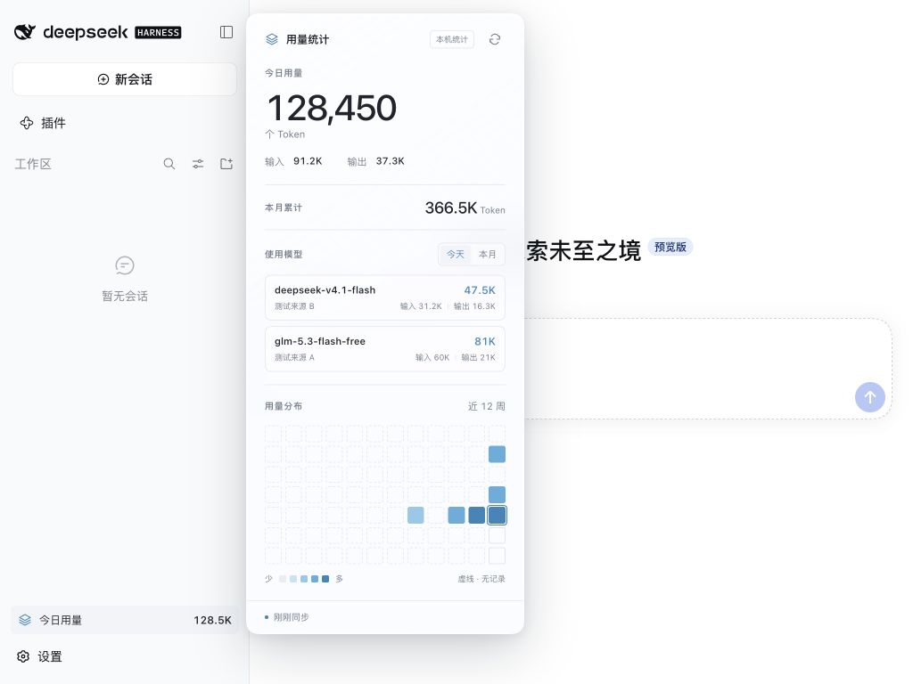
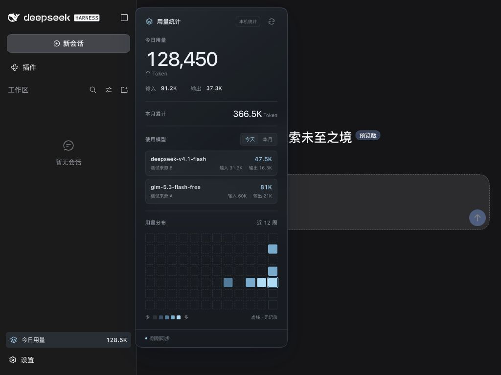
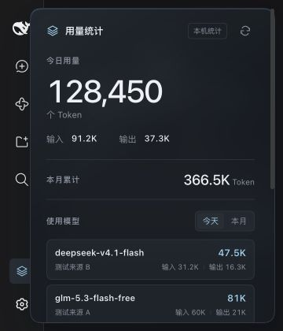

# DSH Mini Usage 1.1

独立、仅本地的 DeepSeek Harness Token 用量插件。面向 **macOS Desktop 0.2.0-rc.2**。

提供 32px 侧栏入口、今日总量 / 输入 / 输出、本月累计、最近 12 个自然周的 7 × 12 热力图。跟随宿主明暗主题，支持手动与每 5 分钟刷新、键盘操作、窄侧栏图标模式、窗口边缘避让。中文界面配合半透明磨砂卡片；新增使用模型的今天/本月切换，显示真实模型标识及输入、输出、总量。没有余额、费用、排行榜或外部统计服务。

## 安装与管理

使用发行包 `dsh-mini-usage-1.1.0.tgz`，通过官方 CLI 安装：

```sh
dsh plugin --profile desktop add /完整路径/dsh-mini-usage-1.1.0.tgz
```

**先完全退出桌面客户端，安装后重新打开。** 安装会更改 desktop profile，须由用户明确执行或授权。详情见 [INSTALL.md](INSTALL.md)。设置的插件管理中可禁用/启用此包；卸载使用 `dsh plugin --profile desktop remove dsh-mini-usage`。

## 统计口径

数据源为宿主 `sessionPersistence.list()` / `open(id, 'read')` / `read(offset, length)`，没有直接扫描用户目录或依赖 usage-stats。覆盖当前 DSH_HOME 中持久化服务可枚举的 Session（含子会话），不只统计当前聊天。正在流式生成、尚未结算到日志的调用在下一次成功刷新后显示。

- 按 rc.2 官方 token-meter 结算语义读取 `assistant/message.data.usage`，否则读取 message/attempt 内嵌 stream 最后一条 usage。流式 sample 是累计值，不逐条相加。
- 同一 turn/step 的结算替换前值；`llm/retry-started` 关闭替换位置，使重试单独累计。seq 游标防止重复事件。fork 的 `inheritedEventCount` 前缀不重复计入全局总量。
- **Input = inputTokens + cacheReadTokens + cacheWriteTokens**。DSH 的 inputTokens 是未缓存部分。Output = outputTokens。Total = Input + Output；reasoningTokens 不额外相加。上游提供 totalTokens 时校验一致性，不一致显示未知。
- 采用系统本地时区、结算事件的自然日。跨日的更正归到更正事件日期；相同值重复结算保留原日期。时区变更后重建索引。
- **`—` 表示没有记录或统计不可用，不等于 0**。有明确零 Usage 才显示 0。当天存在缺失/异常 Usage 或不提供 Usage 的 LLM compaction 时，该日及所属月显示未知；热力图工具提示解释原因。
- 热力图从 11 周前周一到本周日，未来单元格不展示用量；空心虚线为无记录/不可用，实心最低色阶为已报告的真实零。色阶是当前窗口每日总量的相对强度。
- 只覆盖公开日志中可获取的调用。没有持久化 Usage 的后台模型调用、已删除的会话、其他 DSH_HOME 和账号服务端账单不在统计范围，不能视作 API 账户全量账单。

## 模型统计（1.1 新增）

优先使用结算消息的 `message.source.provider/model`，没有结算来源时使用最近 `request/header.header.config` 中的路由。缺少信息时显示“未标注模型 / 来源未标注”，不从聊天文字、密钥或个人配置推测。相同模型的不同来源分开统计，跨会话的同一路由合并。模型列表按名称固定排序，支持今天/本月切换；超过可见高度可滚动查看。

模型与整体共用同一份去重折叠。最终来源修正不重复计数；Usage 相同的来源修正保留原统计日。历史日志会在首次升级时重建 v3 派生索引，以补齐模型归属；原 v2 索引保留供旧版回退。已删除或缺失的原始历史不猜补。

磨砂效果通过本卡片的 backdrop-filter 实现，随宿主明暗主题变化；不支持模糊或开启降低透明度/增强对比度时使用实色背景。

## 性能与持久化

首次建立索引读取可用历史。以后通过 backend revision 跳过未变化日志，变化日志分批读取（每批最多 512 事件）；重启后只检查缓存游标与新增尾部，revision 不跨服务实例信任。官方存储后端在首次打开某个变化日志时仍可能解压完整文件，这不由插件控制。每次刷新需枚举 Session 元数据，成本随会话数增长。

派生缓存：`${DSH_HOME:-~/.dsh}/storages/dsh-mini-usage/index-v3.json`。只保存每日数值、模型与来源标识、游标和最后结算位置，不存聊天内容或认证数据。缓存采用临时文件 + rename；损坏可从官方记录重建。所有读取成功才发布新快照；失败保留旧快照和旧同步时间，并标记过期。

## 隐私与安全

不注入 credentials/settings/llm 服务，不读 API Key，不修改 Session、宿主程序或现有插件。前端仅访问同源 `/api/dsh-mini-usage`；接口限制回环地址、Host、Origin 和专用请求头，不允许跨域读取。生产插件不发第三方网络请求，不含测试数据。CSS 限定于 `.dmu-*`，弹出层使用 Chromium 原生 Popover，禁用时移除入口、样式、路由、计时器和前端请求。

## 开发与复现

构建机 Node.js 24，pnpm 11；运行时由 DSH 提供 Node/React。构建产物不包含 React 副本或运行时 npm 依赖。

```sh
pnpm install --frozen-lockfile
pnpm typecheck
pnpm test
pnpm build
pnpm pack --pack-destination releases
```

官方 DSH 仅作为开发依赖用于真实 Cordis / JSONL 集成测试。原始仓库与适配依据见 [docs/TECHNICAL.md](docs/TECHNICAL.md)。

## 验证范围

已验证 TypeScript 检查、28 项统计与生命周期测试、打包后加载，以及 macOS Desktop 0.2.0-rc.2 的实际安装与模型用量对账。浏览器检查覆盖明暗主题、小窗口与多个 Footer 入口。其他操作系统与宿主版本尚未验证。

## 界面预览

下列截图来自隔离测试环境，数值为合成测试数据。





## English

A local-only token usage plugin for DeepSeek Harness Desktop 0.2.0-rc.2. It adds a compact sidebar entry, Chinese frosted-glass panel, daily/monthly totals, per-model usage and a 12-week heatmap. It reads persisted usage through the official session service, without API keys, chat-content storage or third-party analytics. Missing usage is shown as unknown rather than estimated. It is not an account billing report. Prebuilt host/client files are included; no runtime npm dependencies or install-time build scripts are needed.

## License

MIT. See [LICENSE](LICENSE).
